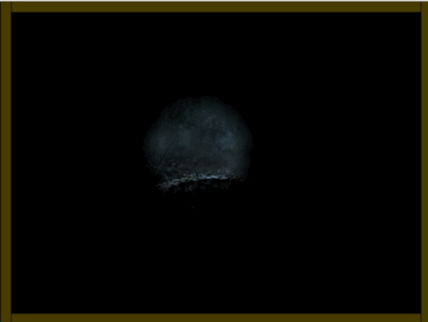
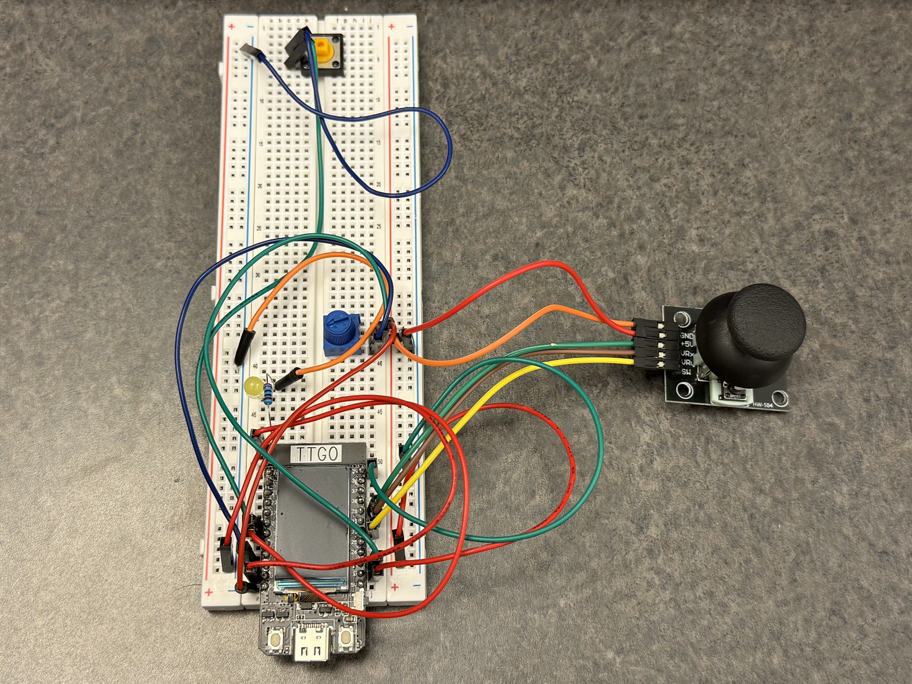

# Well

Module 2: Interactive Devices · Helena Mo

Well is a small horror game I made with an ESP32 and Processing. The scene is a dark forest, and the player uses a flashlight to find a well. My idea came from the scene in the Japanese film Ring *リング* where Sadako crawls out of a television.

[Project blog and videos](https://helenamoisme.github.io/well/)

## How to play

- Move the joystick to move the flashlight.
- Turn the potentiometer to change the flashlight size.
- Find the well and press the joystick switch. A ghost will appear.
- Press the separate button to return to the forest.

## Hardware and wiring

I used an ESP32 TTGO T-display, a joystick, a potentiometer, a button, an LED with a resistor, a breadboard, jumper wires, and a USB data cable.

| Part | ESP32 GPIO |
| --- | --- |
| Joystick X | 39 |
| Joystick Y | 32 |
| Joystick switch | 33 |
| Potentiometer middle pin | 27 |
| Separate button | 2 |
| LED | 15 |

Connect the joystick power and the potentiometer's outer pins to 3.3 V and GND. Connect all grounds together. The joystick switch and separate button connect their GPIO pins to GND when pressed. The code uses `INPUT_PULLUP` for both switches. Use a resistor with the LED.

Fritzing diagram: still to be added.

## How to run

1. Install Arduino IDE with ESP32 board support, and install Processing in Java mode.
2. Connect the ESP32 to your laptop by USB. Open `code/WellArduino/WellArduino.ino`, select your board and port, and upload it.
3. Close the Arduino Serial Monitor.
4. Open `code/WellProcessing/WellProcessing.pde` in Processing. Keep `well.png` and `ghost.png` in its `data` folder.
5. Check the port list printed by `Serial.list()`. Change the number in `Serial.list()[1]` to match your ESP32 port.
6. Run the Processing sketch. Both programs use 9600 baud.

You need the controller connected to play. The blog only shows the project and videos.

## Code

The ESP32 sends five values to Processing every 100 ms: joystick X, joystick Y, joystick switch, potentiometer, and the separate button.

Processing uses these values to move and resize the flashlight. Pressing the joystick inside the well area shows the ghost. The separate button hides it again.

At first, my flashlight was just a circle with a sharp edge. I wanted it to look less flat, so I added a fade with AI help. The code uses the distance from each pixel to the flashlight center to blend the image into black near the edge.

## AI support and references

I used **Codex, GPT-6.1 Sol light** to generate the forest and ghost images and help with the flashlight fade. Both my Arduino and Processing code also refer to Professor Tseng’s Lab 2 sample code.

These are summaries of what I asked, not the exact saved prompts:

- Generate a dark forest at night with a well.
- Generate a scary female ghost coming out of the well.
- Help me add a soft fade to the edge of my flashlight in Processing.
